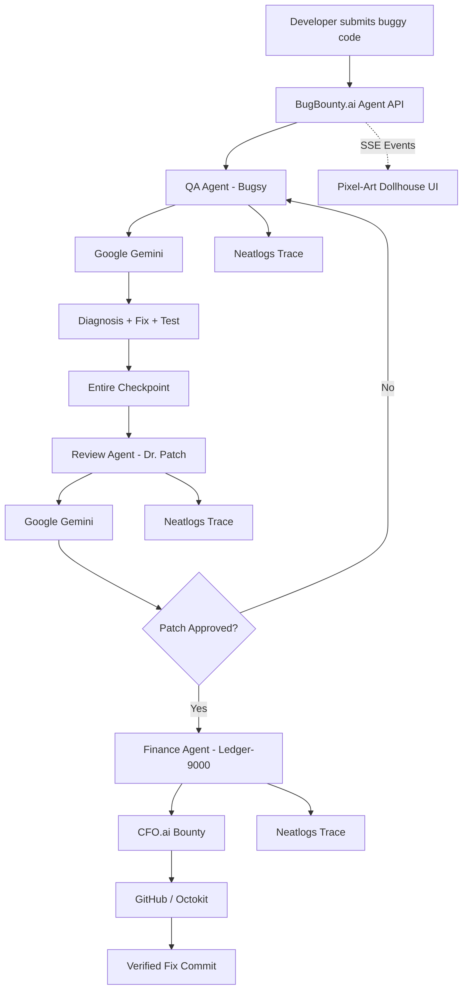

<div align="center">

# 🐛 BugBounty.ai

### An autonomous AI software agency that finds bugs, reviews fixes, tracks every decision, and rewards verified work.

**Turn a buggy code snippet into a diagnosed, reviewed, traceable and rewarded fix — autonomously.**

Built with **Google Gemini · Neatlogs · Entire · CFO.ai · GitHub**

</div>

---

## The Idea

Software bugs rarely fail because nobody can write a fix.

The difficult part is everything around the fix:

- understanding what actually went wrong,
- generating a safe patch,
- reviewing that patch independently,
- knowing what the AI did and why,
- keeping a traceable history of every decision,
- and connecting successful engineering work to measurable outcomes.

**BugBounty.ai turns that entire process into an autonomous multi-agent workflow.**

A developer submits buggy code. From there, a small AI software agency takes over.

The QA agent investigates the bug.  
The reviewer independently verifies the proposed patch.  
Every important step is observed through **Neatlogs**.  
The context is preserved through **Entire checkpoints**.  
Once the fix is approved, the Finance Agent releases a bounty through **CFO.ai**.  
Finally, the verified result can be committed back to **GitHub**.

And instead of hiding all of this behind another dashboard, BugBounty.ai visualizes the process as a **pixel-art software office**, where the agents physically move between departments as the real backend workflow progresses.

---

# ✨ What BugBounty.ai Does

```text
                BUGGY CODE
                    │
                    ▼
        ┌─────────────────────┐
        │     QA DEPARTMENT   │
        │       Bugsy         │
        │                     │
        │ Gemini diagnoses    │
        │ the bug + proposes  │
        │ a fix and test      │
        └──────────┬──────────┘
                   │
             Neatlogs Trace
                   │
             Entire Checkpoint
                   │
                   ▼
               🛗 Elevator
                   │
                   ▼
        ┌─────────────────────┐
        │   REVIEW DEPARTMENT │
        │      Dr. Patch      │
        │                     │
        │ Gemini performs an  │
        │ independent review  │
        └──────────┬──────────┘
                   │
             Neatlogs Trace
                   │
                   ▼
               🛗 Elevator
                   │
                   ▼
        ┌─────────────────────┐
        │ FINANCE DEPARTMENT  │
        │     Ledger-9000     │
        │                     │
        │ CFO.ai processes    │
        │ the bounty          │
        └──────────┬──────────┘
                   │
                   ▼
            Verified Fix
                   │
                   ▼
          GitHub Commit / Push
```

---

# 🎮 The Pixel-Art Software Agency

BugBounty.ai is deliberately designed differently from a conventional developer dashboard.

The interface is a **three-floor pixel-art office** representing the autonomous workflow:

### Floor 3 — QA Department

**Agent: Bugsy**

Bugsy receives the submitted code and asks Gemini to:

- identify the bug,
- determine its root cause,
- explain why it fails,
- generate a corrected implementation,
- and create a verification test.

Once the diagnosis is complete, its context is preserved as a checkpoint.

---

### Floor 2 — Review Department

**Agent: Dr. Patch**

The QA agent travels down to the Review Department and hands over the checkpoint.

Dr. Patch performs a second AI review of:

- the original implementation,
- the diagnosis,
- the proposed fix,
- the generated test,
- regression risk,
- and security implications.

Only an approved fix proceeds to the financial stage.

---

### Floor 1 — Finance Department

**Agent: Ledger-9000**

Once the patch has passed review, the Finance Agent handles the reward stage.

The workflow creates a bounty record containing information such as:

- bounty amount,
- recipient,
- transaction metadata,
- audit information,
- and resulting ledger state.

This connects autonomous software engineering to an actual measurable outcome:

> **No verified fix → no bounty.**

---

# 🔭 Neatlogs — The Observability Backbone

AI agents are useful only when we can understand what they are actually doing.

That is why **Neatlogs is not an add-on in BugBounty.ai — it acts as the observability layer of the autonomous workflow.**

Every important stage of the pipeline can generate telemetry around:

- workflow initialization,
- Gemini model execution,
- QA diagnosis,
- agent decisions,
- Entire checkpoint creation,
- reviewer completion,
- API calls,
- errors and failures,
- request latency,
- bounty execution,
- and workflow completion.

The project integrates the Neatlogs SDK directly into the server and wraps the Google GenAI client so model activity can be observed alongside the rest of the workflow.

This makes a multi-agent system far less opaque.

Instead of asking:

> "Why did the AI do that?"

we can inspect the execution path that led to the result.

### Why this matters

Agentic applications involve multiple models, APIs and state transitions. A failure may happen inside the model, between agents, during an external API call, or while persisting state.

Neatlogs gives BugBounty.ai visibility across that chain.

It helped turn the system from a collection of AI calls into an **observable autonomous pipeline**.

---

# 🧠 Google Gemini — The Intelligence Layer

Gemini powers the reasoning performed by the software agents.

BugBounty.ai currently uses the Google GenAI SDK on the server for two distinct responsibilities.

### Agent 1 — QA Analysis

Gemini analyzes the submitted code and produces structured information containing:

```json
{
  "bugTitle": "Bug description",
  "rootCause": "Why the bug exists",
  "explanation": "Why the code fails",
  "bugLine": 3,
  "proposedFix": "Corrected implementation",
  "testCase": "Test verifying the fix"
}
```

### Agent 2 — Independent Review

A second model call acts as the code reviewer and evaluates the proposed patch.

The reviewer returns information such as:

```json
{
  "approved": true,
  "reviewNotes": "Review result",
  "securityScore": "A+",
  "finalCleanCode": "Verified implementation",
  "regressionRisk": "Low"
}
```

Separating **diagnosis** from **review** makes the workflow more robust than simply allowing one agent to generate a fix and approve its own work.

---

# 🧩 Entire — Memory, Context and Checkpoints

Autonomous coding should not be a black box that forgets what happened after every run.

BugBounty.ai uses **Entire** to preserve the context surrounding agent work.

A checkpoint can contain:

- bug title,
- root cause,
- original code,
- proposed fix,
- generated test case,
- issue ID,
- responsible agent,
- branch information,
- and timestamp.

Entire is enabled directly inside the repository:

```text
.entire/settings.json
```

with Git-ref based checkpoints enabled.

The project also commits checkpoint information alongside autonomous fixes, allowing a code change to remain connected to the reasoning and session that created it.

Example structure:

```text
checkpoints/
├── chk_ent_....json
├── chk_ent_....json
└── chk_ent_....json
```

This creates something especially important for autonomous development:

> **A history not only of what changed, but why it changed.**

---

# 💰 CFO.ai — Outcome-Based Bounties

BugBounty.ai treats a successful fix as an economic event.

A bounty is not released when an AI simply generates code.

It is released **only after the proposed fix has passed the review stage**.

The Finance Agent then creates a CFO.ai payment/ledger action containing:

```text
Amount
Currency
Destination
Bounty action
Authorization metadata
Audit memo
Transaction reference
```

For the demo workflow, the standard bounty is:

```text
$50.00
```

This introduces an interesting model for autonomous engineering systems:

### Pay for verified outcomes, not model activity.

Instead of measuring how many prompts or tokens an agent used, BugBounty.ai associates value with a completed and reviewed engineering result.

---

# 🐙 GitHub — Closing the Loop

After a fix has been verified, BugBounty.ai can automatically create a GitHub commit containing the generated patch.

The GitHub integration uses **Octokit**.

Generated fixes are stored using their associated checkpoint ID:

```text
fixes/
└── chk_ent_<checkpoint-id>.ts
```

Commit messages preserve the relationship between the fix and the autonomous workflow:

```text
fix(autofix): resolve <bug title>
(Checkpoint: chk_ent_...)
```

The workflow therefore closes the loop:

```text
Code
 ↓
AI diagnosis
 ↓
Checkpoint
 ↓
Review
 ↓
Bounty
 ↓
Verified GitHub commit
```

---

# ⚡ Real-Time Agent Orchestration

The backend does not wait for the entire workflow to finish before updating the interface.

BugBounty.ai streams workflow events to the frontend using **Server-Sent Events (SSE).**

Examples include:

```text
agent_move
agent_speak
elevator_move
step_update
gemini_result
neatlogs_trace
entire_checkpoint
```

The frontend consumes these events and turns backend state into animation.

For example:

```text
Backend:
"QA analysis completed"

        ↓

SSE event

        ↓

Frontend:
Bugsy speaks

        ↓

QA agent walks to elevator

        ↓

Elevator moves to Floor 2

        ↓

Reviewer starts working
```

The animation is therefore not just decorative.

It is a visual representation of the underlying agent workflow.

---

# 🏗 Architecture



---

# 🔄 Complete Workflow

### 1. Submit Code

The user pastes buggy code into BugBounty.ai and selects **Run Agents**.

### 2. Start Trace

The backend initializes the autonomous workflow and records the beginning of the run through Neatlogs.

### 3. QA Diagnosis

Bugsy sends the code to Gemini.

Gemini identifies the bug, explains the root cause, proposes a fix and generates a test.

### 4. Preserve Context

BugBounty.ai creates an Entire checkpoint containing the diagnosis and remediation context.

### 5. Agent Handoff

The QA agent walks to the elevator.

The interface receives movement events from the backend and visually transports the agent from Floor 3 to Floor 2.

### 6. Independent Review

Dr. Patch receives the previous agent's context and performs an independent Gemini-powered code review.

### 7. Observe Review

The review outcome and related workflow events are traced through Neatlogs.

### 8. Approve the Patch

If the review succeeds, the patch becomes eligible for the bounty.

### 9. Finance Handoff

The reviewer travels to Floor 1.

Ledger-9000 receives the approved result.

### 10. Release Bounty

The CFO.ai integration creates the bounty/ledger transaction.

### 11. Commit the Fix

The verified patch and checkpoint metadata are committed through the GitHub integration.

### 12. Complete Workflow

The frontend receives the final event and displays the completed autonomous run.

---

# 🛠 Tech Stack

| Layer | Technology |
|---|---|
| Frontend | React 19 |
| Build Tool | Vite |
| Language | TypeScript |
| Styling | Tailwind CSS |
| Animation | Motion + CSS animations |
| Backend | Node.js + Express |
| Agent Streaming | Server-Sent Events |
| AI | Google GenAI / Gemini |
| Observability | Neatlogs |
| Agent Context | Entire |
| Financial Workflow | CFO.ai |
| Source Control Automation | GitHub + Octokit |
| Environment Management | dotenv |

---

# 📁 Project Structure

```text
BugBounty.ai/
│
├── .entire/
│   └── settings.json
│
├── checkpoints/
│   └── checkpoint metadata
│
├── fixes/
│   └── verified autonomous patches
│
├── src/
│   │
│   ├── components/
│   │   │
│   │   ├── dollhouse/
│   │   │   ├── DollhouseBuilding.tsx
│   │   │   ├── ElevatorShaft.tsx
│   │   │   ├── FloorQA.tsx
│   │   │   ├── FloorReview.tsx
│   │   │   ├── FloorFinance.tsx
│   │   │   ├── PixelAvatar.tsx
│   │   │   └── ChatBubble.tsx
│   │   │
│   │   ├── CodeInputPanel.tsx
│   │   ├── CodeDiffModal.tsx
│   │   └── InspectorModal.tsx
│   │
│   ├── server/
│   │   ├── agentWorkflow.ts
│   │   ├── apiRouter.ts
│   │   └── githubService.ts
│   │
│   ├── types/
│   │   └── agent.ts
│   │
│   ├── utils/
│   │   └── sound.ts
│   │
│   ├── App.tsx
│   ├── main.tsx
│   └── index.css
│
├── server.ts
├── package.json
├── vite.config.ts
└── tsconfig.json
```

---

# 🚀 Running Locally

## 1. Clone the repository

```bash
git clone https://github.com/khushi-infinity/BugBounty.ai.git
cd BugBounty.ai
```

## 2. Install dependencies

```bash
npm install
```

## 3. Configure environment variables

Create a `.env` file.

```env
# Google Gemini
GEMINI_API_KEY=your_google_ai_api_key

# Neatlogs
NEATLOGS_API_KEY=your_neatlogs_api_key
NEATLOGS_ENDPOINT=https://ingest.neatlogs.com

# Entire
ENTIRE_API_KEY=your_entire_key

# CFO.ai
CFO_API_KEY=your_cfo_key

# GitHub
GITHUB_TOKEN=your_github_token
GITHUB_OWNER=your_github_username
GITHUB_REPO=BugBounty.ai
GITHUB_BRANCH=main

# Server
PORT=3000
```

> Never commit `.env`, API keys, OAuth tokens or GitHub Personal Access Tokens to the repository.

---

## 4. Enable Entire

Install and authenticate the Entire CLI, then run:

```bash
entire login
```

Inside the repository:

```bash
entire enable
```

You can confirm that Entire is active with:

```bash
entire status
```

---

## 5. Start development

```bash
npm run dev
```

The Vite development server runs on:

```text
http://localhost:3000
```

---

## 6. Build

```bash
npm run build
```

---

## 7. Type-check

```bash
npm run lint
```

---

# 🔌 API

## `POST /api/run-agents`

Starts the complete autonomous workflow and streams events using SSE.

Example request:

```json
{
  "code": "const user = response.data.user.name;"
}
```

The response is an event stream containing agent actions, model results, traces, checkpoints and workflow updates.

---

## `GET /api/config`

Returns the server integration status.

Example:

```json
{
  "status": "ok",
  "keys": {
    "gemini": true,
    "neatlogs": true,
    "entire": true,
    "cfo": true,
    "github": true
  }
}
```

---

## `POST /api/test-integration`

Allows individual integrations to be tested independently.

Supported services include:

```text
gemini
neatlogs
entire
cfo
github
```

---

# 🛡 Why Multiple Agents?

A single LLM could technically:

1. find the bug,
2. write the fix,
3. approve itself.

But that creates a dangerous feedback loop.

BugBounty.ai instead separates responsibilities.

```text
QA Agent
   │
   │ proposes
   ▼
Patch
   │
   │ independently evaluates
   ▼
Review Agent
   │
   │ authorizes
   ▼
Finance Agent
```

Each stage has a different responsibility.

That separation makes the system easier to observe, audit and eventually expand with additional verification agents.

---

# 💡 Why BugBounty.ai?

Traditional AI coding assistants primarily help a developer while the developer remains responsible for orchestrating everything.

BugBounty.ai asks a different question:

> **What if fixing a bug itself became an autonomous, observable and economically accountable workflow?**

That means moving beyond:

```text
Prompt → Code
```

toward:

```text
Problem
   ↓
Diagnosis
   ↓
Evidence
   ↓
Checkpoint
   ↓
Independent Review
   ↓
Verification
   ↓
Reward
   ↓
Commit
```

The result is not merely an AI code generator.

It is an experiment in building an **autonomous software organization**.

---

# 🌟 What Makes It Different

### 🎮 Workflows You Can Watch

The pixel-art office transforms abstract agent state into something understandable.

You can literally watch responsibility move through the organization.

### 🔭 Observable AI

Neatlogs exposes what is happening inside the agent pipeline instead of leaving model calls hidden behind a loading spinner.

### 🧠 Persistent Agent Context

Entire connects agent activity to checkpoints and Git history.

### ✅ Independent Verification

The agent generating the fix is not the same agent responsible for reviewing it.

### 💸 Economic Accountability

CFO.ai connects successful agent work with a bounty, creating a concrete outcome after verification.

### 🐙 Closed-Loop Development

GitHub integration allows the final output to return to the codebase instead of disappearing when the demo ends.

---

# 🔮 Future Scope

BugBounty.ai can evolve far beyond individual code snippets.

Future versions could support:

- automatic GitHub Issue ingestion,
- repository-wide bug investigation,
- pull-request creation,
- sandboxed unit-test execution,
- CI/CD verification,
- dynamic bounty pricing based on bug severity,
- multiple competing fix agents,
- security-specialist agents,
- human approval thresholds,
- reputation scores for agents,
- rollback using Entire checkpoints,
- production incident ingestion,
- automatic vulnerability remediation,
- and organization-wide autonomous engineering workflows.

A future workflow could look like:

```text
GitHub Issue
      ↓
BugBounty.ai
      ↓
Multiple Fix Agents
      ↓
Tests + Security Review
      ↓
Best Patch Selected
      ↓
Human Approval when Required
      ↓
Bounty Settlement
      ↓
Pull Request
      ↓
Production
```

---

# ⚠️ Demo / Development Note

Some integrations in the application contain graceful fallback behavior so that the visual workflow does not completely break when an external credential or service is unavailable.

For a fully connected demo, configure the relevant environment variables and authenticate the external services.

This distinction is intentional: the UI can demonstrate the workflow, while configured integrations provide the real telemetry, checkpoint, financial and repository evidence behind it.

---

# 🏆 Built for #neatHack

BugBounty.ai explores one central idea:

> **Autonomous agents become much more useful when their decisions are observable, their context is preserved, their work is independently verified, and their outcomes are measurable.**

Neatlogs gives us visibility into the agents.

Entire gives their work memory.

Gemini gives them reasoning.

CFO.ai gives verified work an economic outcome.

GitHub closes the loop.

And BugBounty.ai turns all of it into an autonomous software agency you can actually watch work.

---

<div align="center">

## 🐛 Find it. Fix it. Verify it. Reward it.

### BugBounty.ai

[View the Repository](https://github.com/khushi-infinity/BugBounty.ai)

Built with **@arithecfo · @EntireHQ · @neatlogs**

</div>
